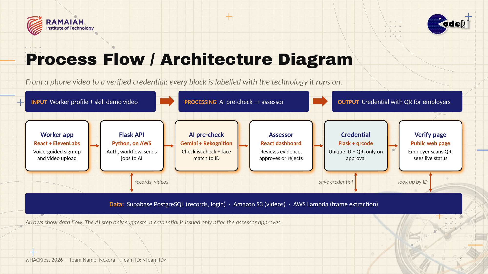

# Architecture

## Flow

**Input:** worker profile + skill demo video → **Processing:** AI pre-check → assessor review → **Output:** credential with QR code that employers can verify.

## Components

| Component | Technology | Responsibility |
|---|---|---|
| Worker app | React + ElevenLabs | Voice-guided sign-up, skill selection, video upload |
| Flask API | Python Flask on AWS | Authentication, role checks, assessment workflow, sends jobs to AI |
| Video storage | Amazon S3 | Stores demo videos privately; signed URLs for assessors |
| Frame extraction | AWS Lambda + FFmpeg | Triggered on each upload; saves ~6 key frames |
| AI pre-check | Google Gemini API | Compares frames with the skill checklist; returns a status per item |
| Identity check | Amazon Rekognition | Matches the face in the video with the worker's ID photo |
| Assessor dashboard | React | Video player, checklist, AI notes, approve/reject with remarks |
| Credential service | Flask + qrcode | Creates a unique credential ID and QR code, only on approval |
| Verify page | Public web page | Employer scans the QR and sees live status: valid, revoked or not found |
| Database | Supabase PostgreSQL | Users, skills, assessments, credentials; login |

## Design decisions

- **Human in the loop.** AI output is advisory. Only the assessor's decision creates a credential, and the assessor is named on it.
- **Live verification, not a file.** The QR encodes a URL with the credential ID; the page reads the record from the database every time, so forged PDFs fail and revoked credentials show as revoked.
- **No blockchain.** Employers trust the assessor, not the storage. A server-side record with live lookup is cheaper, simpler and revocable.
- **Keys stay on the server.** Only the Flask API talks to Supabase, S3, Gemini, Rekognition and ElevenLabs.
- **Privacy by default.** Videos are private; the public page shows only the credential summary.
